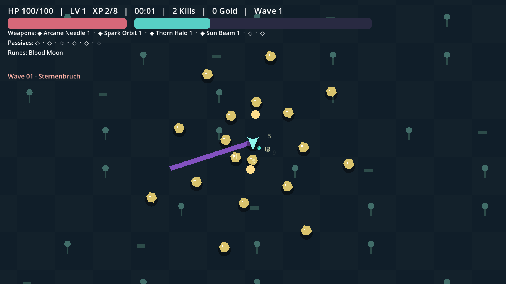

# STERNENBRUCH

An original, offline cosmic-fantasy survivor roguelite. **Godot 4.7.2 Stable**, GDScript 2.0, Compatibility renderer. No plugins, downloaded assets or network services required. All gameplay text is English.



## Play

Import `project.godot` in **Godot 4.7.2 Stable**, then press **F5**. In this cloud environment use `/workspace/tools/godot-4.7.2/Godot_v4.7.2-stable_linux.x86_64`; the system-wide `godot` is an older version.

Choose a hero and arena, select a rune and survive for 30 minutes. Quick mode advances the same waves in 15 real minutes. Weapons fire automatically. Move with WASD, arrow keys or the left controller stick. The player arrow points along the last movement direction and stays pointed that way when stationary.

- 1/2/3: choose a level-up or rune card.
- R/T/B: reroll/skip/banish **after buying their meta upgrades**. They start locked, with no free charges.
- Esc / controller Start: pause. Enter/A confirms; arrow keys/D-pad navigate menus.
- Break lanterns for healing, gold and rare specials; collect chests by touching them.
- Six weapon slots and six passive slots. Weapons have eight levels; passives have five.

## Window and audio settings

The default standalone window is **1920×1080**. Settings offer 1280×720, 1600×900 and 1920×1080. Existing saved resolution choices are preserved. Resolution selection is available in windowed mode; fullscreen uses the display.

Godot's embedded game view belongs to the editor and cannot be resized by the game. Its resolution/fullscreen controls are disabled with an explanation. Disable **Embed Game on Play** / run the project in a separate window to test native resizing. Audio changes never request window resizing or mode changes.

## Progression and pacing

The opening is deliberately measured across movement, enemy pressure and combat. Hero base movement is 75% of the original values (Lyra: 165 px/s); enemies start at 65% speed and spawns at 40% density. Projectiles and orbit/beam rotation begin at 80% speed, while weapon/AI intervals begin 20% longer. Opening modifiers reach normal values smoothly over **eight in-game minutes**. The run clock and boss schedule are unchanged. Heroes retain a generous early speed advantage over normal pursuers.

The Star Forge offers **20 permanent upgrades**. Fleet Foot grants +5% immediate movement speed per rank, starting at 40 gold; Long Stride grants +1% movement speed per in-game minute **per rank**, capped after ten minutes. Additional tempo upgrades include **Swift Missiles** (+6% projectile speed per rank), **Battle Rhythm** (-1% cooldown per minute per rank, capped at ten minutes), **Gathering Flow** (+12% pickup attraction speed per rank) and **Evasive Instinct** (+3% movement per rank while below 50% HP). Regeneration, crit chance, area, duration and instant cooldown upgrades remain available. Reroll, skip and banish must be purchased first. Treasure Hunter can add a reroll only after that feature is unlocked.

The main-menu **Characters** page is read-only: locked heroes show only their names; unlocked heroes show details. Start runs exclusively through **New Run**.

The collection hides weapons, passives and heroes until selected. A starting weapon counts as acquired when starting its hero's run. Merely seeing a card or unlocking a hero does not reveal that entry. Discoveries are saved immediately.

## Equipment and evolution

**15 weapons, 17 passives, 15 weapon evolutions and 2 fusions.**

New weapons: **Prism Disc** bounces between distinct enemies; **Gravity Mine** arms and detonates with pull/slow; **Reaper's Gaze** targets the weakest enemy and deals triple damage below 35% HP.

New passives: **Recovery Moss** regenerates HP, **Execution Seal** increases damage against wounded enemies, **Frost Thorns** retaliates with a slowing nova when contact damage is taken, and **Momentum Feather** increases movement speed over time.

An evolution requires:

1. Its base weapon at **level 5 or higher**.
2. Its matching passive at **level 5**.
3. A chest from a boss **spawned at 10:00 or later**. Opening an older chest later does not upgrade its eligibility.

Example: **Arcane Needle Lv5+ + Power Core Lv5 → Star Piercer** in an eligible boss chest. The weapon is replaced and the passive is kept. Passives do not evolve independently. Fusions require both base weapons at Lv5+ and their matching passive at Lv5; both bases become one weapon, freeing a slot. Recipes are listed in the pause screen and collection **only after successfully performing that evolution or fusion**. Until then, pause shows only a count of undiscovered paths involving your current weapons. Merely owning components does not reveal names or recipes.

## Save compatibility

Save data uses `user://savegame.json`. Existing gold, upgrades, unlocks and settings are retained; the new weapons are added to existing offer pools. Invalid saves are backed up as `.corrupt.bak`. Gold is banked once per run. Meta purchases apply to the next run.

### Reset for testing

From the main menu choose **Settings → Reset All Data… → Reset Everything**. A confirmation is required, with Cancel focused by default. Reset clears gold, meta upgrades, unlocks, discoveries, completed evolution history, achievements, records, statistics and settings; current menu selections return to defaults. The reset action is intentionally not available during an active run.

Completion history is stored separately as `evolved_recipes`. Older saves did not distinguish component discovery from completed evolution, so ambiguous old recipe discoveries remain hidden until performed again. Existing gold and other progress are retained unless you explicitly reset them.

## Validation

```sh
GODOT_BIN=/path/to/Godot_v4.7.2-stable_linux.x86_64 ./tools/check.sh
# CPU load test and complete 30-minute simulation:
GODOT_BIN=/path/to/Godot_v4.7.2-stable_linux.x86_64 ./tools/check.sh --long
```

`tests/window_runner.gd` requires a graphical display and checks actual native window sizes and audio changes. Run it again with Godot's `--wid <parent-window-id>` to verify true embedded mode. `tests/visual_runner.gd` renders menus/gameplay and checks keyboard and simulated stick movement. Captures go to `STERNENBRUCH_CAPTURE_DIR`, or `user://captures` by default.

Headless simulation measures simulation CPU time, not rendered FPS. Physical controller, audible balance, fullscreen/DPI on target hardware, and a human 30-minute balance playthrough remain manual checks. See `STATUS.md`, `DESIGN.md`, `BALANCE.md` and `docs/SMOKE_TEST.md`.

## Debug shortcuts

Only in debug builds and while playing: F6/F7/F8/F9 jump to 09:50/10:00/20:00/29:00; F10 grants XP; F11 grants weapons and matching Lv5 catalysts; F12 drops a real eligible chest and grants run gold. Disabled in release builds. These use production gameplay logic.

## Editing

`resources/` contains editable typed `.tres` definitions. `tools/generate_data.py` regenerates that catalog and overwrites its definition files: keep changes to the generator and resources consistent. `scripts/run_model.gd` owns run stats/progression, `combat.gd` owns attack behavior, `world.gd` owns enemies/loot, `save_manager.gd` owns meta/unlocks, and `window_settings.gd` isolates native window changes.

Automatic combat, minute waves, three upgrade choices, 6+6 slots and chest evolutions are genre inspirations. Names, graphics, audio, world and balance are original. `CODEX_MASTERPROMPT.md` preserves the original German brief; later user-requested changes documented here supersede its original language/balance requirements.

## Phase E work in progress

E1 adds tested save/runtime/statistics foundations. E2–E6 gameplay extensions are not delivered yet. See `docs/FEATURES_PHASE_E.md` and `STATUS.md` for the exact continuation point.
